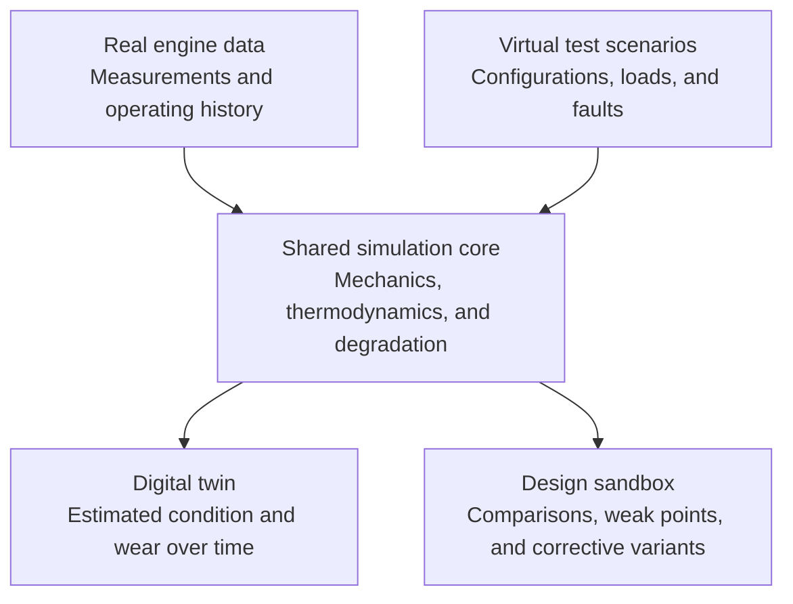

# V-Twin

### Engine digital twins & virtual testing

Track how a real engine ages. 
Explore where a future engine could fail.

[Vision](#vision) · [Applications](#two-applications-one-foundation) · [Roadmap](#roadmap) · [Technical track](#technical-track) · [Get involved](#get-involved)

---

## Vision

V-Twin is an engine modeling and simulation project with two goals: **follow the condition and wear of a real engine**, and **test engine designs in a virtual sandbox before production**.

Both applications will share a simulation core that connects operating conditions to mechanical and thermal loads, then to degradation over time. The aim is to make these relationships observable, explainable, and useful for engineering decisions.

## Current status

> [!NOTE]
> V-Twin is at the **project-definition stage**. This repository is a fresh start. The roadmap is defined; the simulation core, data integrations, and demonstrators are planned work.

The first demonstrator will prioritize **the design sandbox**, with one reference engine and a focused reliability case. The real-engine twin remains a subsequent delivery goal. Engine selection, available evidence, and demonstration criteria are being defined in the [product scope](docs/product-scope.md).

## Two applications, one foundation

| | Digital twin | Design sandbox |
| :--- | :--- | :--- |
| **Purpose** | Follow the evolving condition of a specific real engine. | Explore an engine's behavior and potential weaknesses before production. |
| **Inputs** | Engine configuration, measurements, and operating history. | Design parameters, operating scenarios, environmental conditions, and controlled faults. |
| **Planned capabilities** | Synchronize observations with the model, estimate state and wear, and explain changes over time. | Compare configurations, explore demanding conditions, reproduce weaknesses, and assess corrective variants. |
| **Evidence of success** | Estimates agree with independent observations of the engine and the component being tracked. | The sandbox reproduces a known weakness and evaluates a correction against reference evidence. |

### Digital twin: follow a real engine

The twin will use an engine's measurements and operating history to maintain an estimate of its condition. It should help users understand how accumulated use affects the component being tracked, where the available data supports an estimate, and why a change or alert appears.

The planned workflow covers data import, quality checks, engine-specific calibration, state updates, historical replay, and a view of estimated wear with its uncertainty.

### Design sandbox: explore before production

The sandbox will let users define engine configurations and run repeatable experiments under different loads, transients, environments, and physically supported faults.

The goal is to locate potential weak points, understand the conditions that trigger them, and compare a proposed correction against the original design using the same scenarios and metrics.

## How it fits together

The planned flow brings measured operation and virtual experiments into the same modeling foundation:

The architecture and technology stack will be selected during the foundation phase. The core is intended to run independently of the interface so that recorded sessions and simulation campaigns can be replayed and compared.

## Modeling principles

- **Ground models in physical evidence.** Document equations, units, parameter sources, assumptions, and the operating conditions each model supports.
- **Keep measurements and estimates distinct.** Make the origin of each output visible, including whether it is measured, estimated, or a load indicator.
- **Make experiments reproducible.** Preserve model versions, configurations, initial states, input histories, and numerical settings for each run.
- **Validate on independent observations.** Separate calibration data from evaluation data and report errors, uncertainty, and coverage.

A load indicator becomes a calibrated wear estimate only when the relationship is supported by measurements. Remaining-life prediction will require its own failure model and validation before becoming a product capability.

## Roadmap

The roadmap contains **47 objectives across 7 milestones**: 28 product objectives and 19 supporting objectives for technology evaluation, architecture, expert collaboration, and technical performance. Each objective has a deliverable, acceptance criteria, a priority, and explicit dependencies.

| Milestone | Focus | Completion target |
| :--- | :--- | :--- |
| [M0 · Define the problem](https://github.com/V-Twin-EIP/V-Twin/milestone/1) | Scope, reference engine, data, and validation protocols. | An accessible reference case and measurable success criteria for both applications. |
| [M1 · Build the foundation](https://github.com/V-Twin-EIP/V-Twin/milestone/2) | Architecture, data contracts, CI, and a runner without a graphical interface. | A versioned engine configuration can be simulated, recorded, and replayed reproducibly. |
| [M2 · Model engine physics](https://github.com/V-Twin-EIP/V-Twin/milestone/3) | Mechanics, gas exchange, combustion, thermal behavior, and relevant lubrication conditions. | Mechanical and thermal outputs meet defined tolerances against reference data. |
| [M3 · Model wear](https://github.com/V-Twin-EIP/V-Twin/milestone/4) | A first degradation mechanism, calibration, and uncertainty. | Wear estimates are evaluated against independent observations within a documented domain. |
| [M4 · Connect the digital twin](https://github.com/V-Twin-EIP/V-Twin/milestone/5) | Real data ingestion, engine-specific calibration, state history, and monitoring. | A real session can be imported and replayed with traceable state and wear estimates. |
| [M5 · Build the sandbox](https://github.com/V-Twin-EIP/V-Twin/milestone/6) | Scenarios, fault injection, parameter sweeps, and comparison reports. | A reproducible campaign identifies a supported weakness and compares corrective variants. |
| [M6 · Validate and demonstrate](https://github.com/V-Twin-EIP/V-Twin/milestone/7) | Independent benchmarks, a real-engine demonstration, and a design case study. | Both applications have reproducible demonstrations with documented results and limits. |

Milestones are driven by evidence and dependencies. Data collection should begin early; acquisition work and sandbox development can progress in parallel once their prerequisites are met.

**Explore the plan:** [GitHub Project](https://github.com/orgs/V-Twin-EIP/projects/1) · [Roadmap issues](https://github.com/V-Twin-EIP/V-Twin/issues?q=is%3Aissue+label%3Aroadmap) · [Milestones](https://github.com/V-Twin-EIP/V-Twin/milestones)

The project board requires access to the organization's private project. The roadmap issues and milestones are also linked directly above.

## Technical track

V-Twin follows four selected Epitech Technical Track objectives. Issues use cumulative labels to show which objectives they support:

| Objective | Issue label | Expected evidence |
| :--- | :--- | :--- |
| **Mandatory 1 · Technology watch** | [`track:tech-watch`](https://github.com/V-Twin-EIP/V-Twin/labels/track%3Atech-watch) | Comparative studies, POCs, benchmarks, justified adoption of a new technology, and documented sharing. |
| **Mandatory 2 · Technical architecture** | [`track:architecture`](https://github.com/V-Twin-EIP/V-Twin/labels/track%3Aarchitecture) | Architecture and UML diagrams, technical documentation, configuration, quality reports, critical-module tests, error handling, logging, and initial security. |
| **Selected complementary 1 · Experts** | [`track:experts`](https://github.com/V-Twin-EIP/V-Twin/labels/track%3Aexperts) | Focused external reviews, documented advice, and applied recommendations with verification. |
| **Selected complementary 2 · Performance** | [`track:performance`](https://github.com/V-Twin-EIP/V-Twin/labels/track%3Aperformance) | Two to three primary KPIs, a reproducible baseline, load and resilience tests, and a measured before/after optimization. |

These are planned deliverables. Labels identify contributions to an objective; completion requires linked evidence. The team's proposed targets of four studies, two POCs, and two comparative benchmarks are explained in the [track coverage and evidence plan](docs/technical-track.md).

## Get involved

Start with [M0.1 — Define the scope and user journeys](https://github.com/V-Twin-EIP/V-Twin/issues/1). It establishes the first demonstrator, the reference engine, and the initial wear mechanism.

Contributions can help with engine modeling, instrumentation and datasets, numerical methods, model validation, and the tools that make results understandable. Use the [roadmap issues](https://github.com/V-Twin-EIP/V-Twin/issues?q=is%3Aissue+label%3Aroadmap) to find an objective and review its dependencies and acceptance criteria before proposing work.

For a modeling proposal, include the physical mechanism, assumptions, required inputs, expected outputs, and the evidence that could validate it.

## License

V-Twin is licensed under the **GNU Affero General Public License v3.0 (AGPL-3.0)**. See [LICENSE](LICENSE) for the full text.

---

**From operating history to wear estimates. From virtual experiments to better engine designs.**

