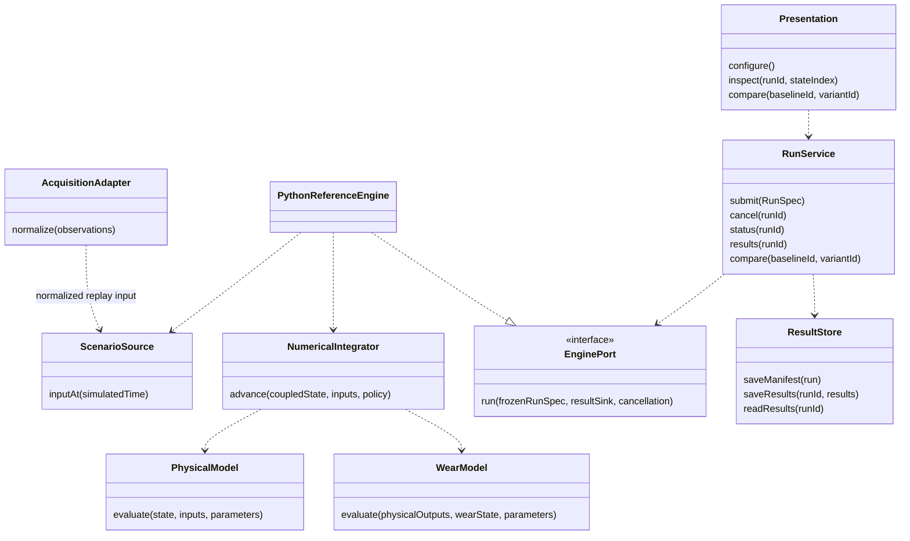
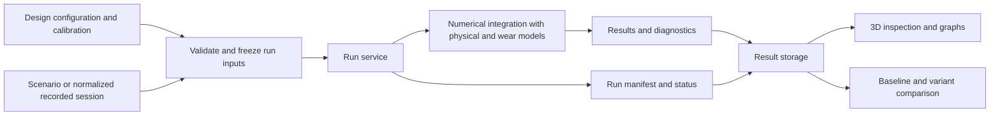
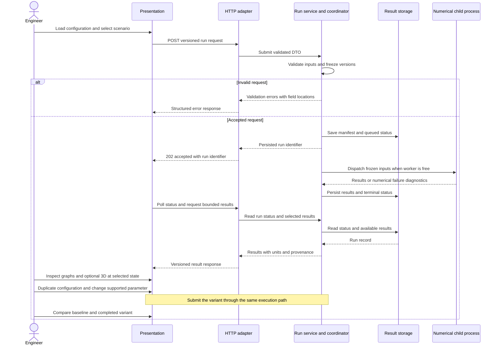
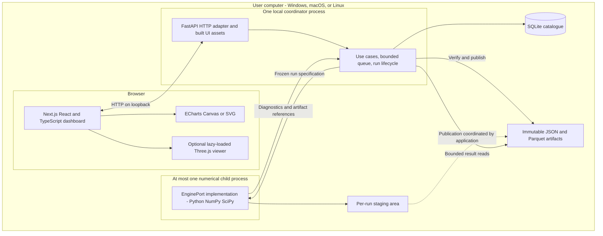

# V-Twin architecture

**Status:** working V1 baseline for [M1.1 #5](https://github.com/V-Twin-EIP/V-Twin/issues/5), reviewed October 26, 2026. Product constraints are confirmed; implementation choices below are documented engineering baselines to evaluate. The [study review and V1 arbitration](adr/0004-study-review-and-v1-boundary.md) records how Slakkos's studies and Adam's scenarios affect these decisions. The validation protocol in #4 and the workloads/KPIs in #3/#39 remain open.

The first delivery runs a parameterized ring–liner case, records its results, and supports interactive 3D inspection, graphs, and a baseline/variant comparison. A dashboard-only mode provides configuration, execution, graphs, comparison, and export without initializing 3D. The later digital twin reuses the model and run contracts with recorded or acquired observations. Model execution remains usable without the interface.

## Constraints and stack

Our team has experience with C/C++, Python, TypeScript, and React. We chose Next.js (React) with TypeScript for the interface and **Python/NumPy/SciPy for V1, with C++ considered according to measurements**. We use batch calculation followed by result exploration, with local web deployment. V1 uses developer installation and documented launch commands. Windows, macOS, and Linux are target platforms. The [October 24 hardware register](../../benchmarks/README.md#machine-register) records a lowest reported RAM capacity of **16 GB**. Pacien's i5-1135G7/Iris Xe is the integrated-graphics profile; Divin's i5-7300HQ/GTX 1050 Ti is a separate CPU/dedicated-GPU profile. Raphael and Mathieu each have an M4/16 GB MacBook Pro; Adam has an i7-13620H/32 GB/RTX 5060 Laptop GPU. Exact OS/browser versions and measured graphics/performance qualification remain pending.

| Layer | Working V1 choice | Decision |
| :--- | :--- | :--- |
| Interface | Next.js (React), TypeScript, App Router; static export planned for local hosting. Migration from the existing Vue/Vite scaffold is pending. | [ADR 0001](adr/0001-local-application-and-ui-boundary.md). |
| 3D and graphs | Three.js viewer adapter; Apache ECharts with Canvas/SVG for dashboard plots. 3D is optional per client/session. | [ADR 0001](adr/0001-local-application-and-ui-boundary.md). |
| Local API | FastAPI, versioned HTTP/JSON contracts and OpenAPI; polling for batch status. | [ADR 0001](adr/0001-local-application-and-ui-boundary.md). |
| Reference numerical engine | Python, NumPy, SciPy; CPU execution, binary64 baseline, model-specific numerical policy. | [ADR 0002](adr/0002-reference-engine-and-numerical-policy.md). |
| Optional native implementation | C++ behind the engine contract if model/library needs or measured costs justify it; pybind11 is a candidate binding. | [ADR 0002](adr/0002-reference-engine-and-numerical-policy.md). |
| Local execution | One coordinator and at most one numerical child process at a time; bounded persisted job queue. | [ADR 0003](adr/0003-local-execution-and-storage.md). |
| Persistence | SQLite catalogue, frozen JSON manifests/configuration, Parquet numerical histories through PyArrow. | [ADR 0003](adr/0003-local-execution-and-storage.md). |

The ADRs compare alternatives and link primary documentation. These choices are not benchmark results. The numerical method and physical tolerances depend on the selected equations and #4; live-telemetry transport/storage remain subjects of Slakkos's studies.

## Components and dependencies

| Component | Responsibility | Boundary |
| :--- | :--- | :--- |
| Physical model | Evaluate supported mechanical, thermal, and lubrication quantities for a declared state and operating condition. | No rendering, network, database, or wall-clock dependency. |
| Wear model | Evaluate the selected degradation mechanism using physical outputs, material/calibration parameters, and its applicability conditions. | Keep physical wear estimates distinct from exposure indicators; declare the coupling to the physical model. |
| Numerical integration | Advance the coupled state under a documented numerical policy and report solver diagnostics. | The runner owns advancement; the viewer cannot change solver time or step size. |
| Scenario and replay | Provide operating inputs against simulated time from a controlled scenario or a recorded session. | Validate units, ordering, gaps, and any resampling policy before execution. |
| Run service | Validate a run request, freeze configuration/model versions, coordinate execution through an engine/execution port, and manage run status. | Shared use cases for HTTP and CLI adapters; no dependency on React/Next.js or FastAPI. |
| Result storage | Preserve run metadata, inputs, diagnostics, time series, and reproducible result artifacts. | Expose storage operations through a contract independent of the physical model. |
| Acquisition adapters | Convert future vehicle/file/transport observations into the observation contract. | Hardware/transport choices remain in #30/#31; acquisition does not run inside a numerical step. |
| Presentation | Configure a case, inspect simplified 3D geometry, display graphs, and compare recorded runs. | Render results from a selected run and state; rendering frequency does not determine numerical integration. |

The diagram shows logical dependencies rather than deployed services or existing source files.



## Simulation flow



The first comparison changes the supported lubricant viscosity configuration while keeping geometry and scenario fixed. A comparison checks compatible observable definitions and scenario/model provenance before overlaying curves. It reports the changed inputs rather than assuming two runs differ only in the intended parameter. The stored histories and comparison semantics are shared between dashboard-only and 3D modes.



## Local deployment and execution

This is a modular application with a local worker, rather than independently deployed business services. The browser communicates only with the API. The coordinator owns catalogue changes; a worker writes only its assigned staging artifacts and returns bounded diagnostic/artifact references.



The normal local launch serves the built UI and `/api/v1` from the same loopback origin; Node is a build/development dependency rather than a numerical runtime. The selected Next.js frontend will use static export for local hosting and a configured local API connection during development. The existing scaffold still uses Vite; migrating the build, development setup and smoke checks remains implementation work. The [foundation guide](../development.md) documents the current startup/metadata API and commands. The worker, job lifecycle, persistence, and simulation contracts below remain the target architecture for subsequent issues.

Persist a queued run before acknowledging it, then transition through `queued`, `running`, and a terminal `completed`, `failed`, `cancelled`, or `interrupted` state. A cancellation request is an event while work stops; it is not immediate success. Bound queue length, simulation duration, output volume, and result-query sizes. Initial limits are selected and measured in #39 rather than inferred from the 16 GB reference-system capacity.

Our UX target is **at most 60 seconds from submitting a nominal case to usable dashboard results**, on a fixed workload and reference environment. Measure the complete path, including any nominal queue wait, numerical execution, publication, retrieval, and initial graphs; report the component durations as well. Busy-queue and startup scenarios have separate measurements. This is an acceptance target to test in #39, not an established performance result or a forced numerical cutoff.

The coordinator supervises worker exit, timeout, cancellation, staging publication, and startup reconciliation. CLI execution must respect exclusive workspace ownership: use the running coordinator's API or an independently locked workspace. A second CLI process cannot start a competing scheduler against an active workspace. Recovery and backup semantics are defined in ADR 0003.

## Replaceable interfaces

The **HTTP contract** separates the UI from the application/runtime. The **EnginePort contract** separates application orchestration from a particular numerical implementation. Replacing a UI preserves API behavior; replacing the engine also requires numerical/domain equivalence within the evaluation tolerances. Changing both remains possible through their independently versioned adapters.

| Boundary | Proposed operation | Semantics to finalize in #7 |
| :--- | :--- | :--- |
| HTTP | `GET /api/v1/capabilities` | Supported models, schema/API compatibility, and application capabilities. Browser graphics support is detected by the client. |
| HTTP | `POST /api/v1/runs` | Validate and persist a frozen run request, then return an accepted run identifier; reject invalid or over-limit work explicitly. |
| HTTP | `GET /api/v1/runs/{id}` | Status and available progress/diagnostics. Do not fabricate a percentage when the engine cannot provide one. |
| HTTP | `POST /api/v1/runs/{id}/cancel` | Request cancellation; status reports when the worker has actually stopped. |
| HTTP | `GET /api/v1/runs/{id}/manifest` | Immutable inputs, observable definitions, versions, provenance, and evaluated domain. |
| HTTP | `GET /api/v1/runs/{id}/series` | Selected observables and time interval with response limits and any display derivation identified. |
| HTTP | `POST /api/v1/comparisons` | Validate baseline/variant compatibility and record the comparison request and changed inputs. |
| HTTP | Artifact/export retrieval by run and artifact IDs | Return authorized application-owned files without accepting arbitrary host paths. |
| Engine | `run(frozen_spec, result_sink, cancellation)` | Pure numerical use of resolved domain inputs; documented diagnostics, artifact/result contract, and terminal outcome. No HTTP objects or browser state. |
| Frontend | API client and viewer/chart adapters | Map versioned DTOs to presentation state; keep React/Next.js, Three.js, and ECharts-specific objects out of shared model contracts. |

The OpenAPI document will be exported and versioned with the implementation; generate/check frontend DTOs against it. A new UI still needs its own presentation work, while the same configuration, run, and result semantics remain usable. Third-party executable plugins and arbitrary user-supplied model code are outside V1.

## Domain contracts

The contracts below define responsibilities for #5. [Schema implementation #7](https://github.com/V-Twin-EIP/V-Twin/issues/7) supplies concrete fields, formats, examples, and validation tests.

| Contract | Required meaning |
| :--- | :--- |
| Design configuration | Engine/contact geometry, materials, lubricant configuration, initial/boundary conditions, units, and parameter provenance. Immutable for a submitted run. |
| Calibration parameters | Identified calibration dataset/procedure, fitted values, applicability, and model version. Separate from editable design parameters. |
| Engine state | Evolving physical and degradation state at simulated time; initial state and restart state identified separately. |
| Scenario or observations | Time-indexed forcing or observations with units, source, coverage, and quality. Synthetic inputs and measurements retain separate origins. |
| Run specification | References to frozen inputs, model/schema/code versions, numerical policy, initial state, scenario, and a random seed if a stochastic model requires one. |
| Observable | Stable identifier, definition, unit, origin category, sampling coordinate, supported domain, and validity/quality. Uncertainty is recorded when the evaluation method provides it. |
| Run record | Identifier, manifest, lifecycle status, results, diagnostics, and terminal error/cancellation reason. Partial results retain an incomplete status. |

### Time and units

The internal baseline uses SI units: time in seconds, length in metres, temperature in kelvin, pressure in pascals, and angles in radians. Boundary adapters perform explicit conversions for entries or displays such as millimetres, degrees Celsius, bar, degrees, and RPM. Unit definitions, dimensions, and pressure/temperature reference conventions accompany parameter and observable contracts.

Simulated time advances according to the numerical policy. Wall-clock time measures execution cost, and acquisition timestamps identify source observations. These are separate coordinates. The renderer selects a stored state or an explicitly defined interpolation for playback without changing simulation history. Cycle/angle indexing and the mapping to time will be specified with the operating scenario.

The numerical policy records the method, floating-point precision, integration/output steps, convergence criteria, error controls, and failure conditions. Binary64 is the initial numerical baseline. The candidate ODE path and the treatment of possible contact-field/algebraic subproblems are defined in ADR 0002. Per-observable tolerances and the evidence for them come from [validation #4](https://github.com/V-Twin-EIP/V-Twin/issues/4). No precision or speed target is inferred from a rendering frame rate.

## Module structure and versioning

The following is the target source layout. The [foundation module map](../development.md#module-responsibilities) identifies the implemented subset; physical models, storage/acquisition adapters, full contracts, and visualization remain later work. The Python numerical package is usable with its core dependencies alone; HTTP/storage integration dependencies belong to explicit adapters or installation extras.

```text
src/vtwin/
  domain/          # design, calibration, state, observables, run records
  engine/          # physical/wear models, scenarios and numerical policies
  application/     # submit/run/cancel/compare use cases and lifecycle
  ports/           # engine, execution and result-store contracts
  adapters/
    http/          # FastAPI routes and boundary DTO validation
    cli/           # command-line entrypoints
    execution/     # supervised local child process
    storage/       # SQLite catalogue and JSON/Parquet result adapters
    acquisition/   # later file/OBD/transport normalization
  bootstrap/       # explicit composition of implementations and configuration
web/
  src/
    api/           # versioned client and DTO mapping
    features/      # configuration, runs, dashboards and comparisons
    visualization/ # optional viewer and chart adapters
schemas/           # versioned interchange contracts and OpenAPI exports
tests/             # core, contract, adapter and recovery checks
benchmarks/        # fixed workloads and measured environment/results
docs/architecture/ # design and ADRs
```

Domain/engine modules do not import HTTP, persistence, or rendering adapters. Use explicit composition rather than runtime plugin discovery. Changes to a solver/backend/model get distinct implementation identifiers. A run manifest records the source commit, dependency lock references, configuration/scenario/calibration digests, schema/model versions, numerical policy, and relevant environment details. Reproduction across platforms is assessed within declared numerical tolerances rather than promised as identical bytes.

Version the HTTP major path, interchange schemas, observable definitions, and storage migrations explicitly. Incompatible stored data must be rejected with a diagnostic or migrated by a documented operation that preserves the original. #6 selects and pins runtime/dependency versions after checking Windows/macOS/Linux and CPU architectures; no untested minimum platform version is advertised here.

## Errors and trust boundaries

Imported configuration, result files, future observations, and interface requests cross an input-validation boundary. Validate schemas, units, finite numbers, physical parameter ranges, dataset references, and requested run limits before execution. Model code and storage paths are application-controlled rather than executable content supplied by a configuration file. Bind the normal service to loopback and validate allowed hosts/origins. The current scaffold exposes only read-only health/capability/schema metadata; require the local launch/session-token controls in #40 before introducing run or result access. Do not enable wildcard browser origins or expose the data directory as static files.

Use distinct errors for invalid input, unsupported model conditions, missing evidence or data, numerical failure, storage failure, and cancellation. Correlate diagnostics with a run identifier and retain model-specific details for reproduction. A failed numerical run cannot be displayed as a completed comparison. Detailed implementation is tracked in [#40](https://github.com/V-Twin-EIP/V-Twin/issues/40).

Keep application configuration separate from engine design: data directory, bind address/port, allowed development origins, logging, queue/worker/resource limits, and optional future acquisition credentials. Document these in #41's `.env.example` without secrets or persisted launch tokens. Use a per-user data directory outside Git. UI assets and examples needed at runtime are bundled locally; any optional external service is an explicit capability.

Structured logs carry run IDs, component, severity, and actionable error codes without credentials or launch tokens. #40 implements validation/error/logging controls. ADR 0003 defines publication, interruption reconciliation, and backup/restore across the catalogue and immutable artifacts; #41 implements and exercises it.

## Evidence and remaining decisions

| Decision | Required input or evidence |
| :--- | :--- |
| Numerical formulation, method and tolerances | Selected equations/coupling, validation protocol #4, wear-model study #33, and convergence/accuracy evidence. Binary64 and the candidate ODE adapter are working baselines. |
| Workload, time and memory budgets | Our target: nominal submission-to-usable-results latency at most 60 seconds. Fix scenario/output volume in #3 and measure in #39; verify Pacien's and Divin's reported 16 GB profiles in dashboard-only mode and assess 3D separately. Justify memory/queue limits from those measurements. |
| Cross-platform support | #6/#41: exact OS/browser versions, CPU architectures, dependency installation, launch, persistence, cancellation, and graphics capability checks. |
| Future acquisition and telemetry | #30/#31: real hardware/signals and live transport evidence. No live-vehicle interface is implemented by this design. |
| Future history store | #32/#43: InfluxDB/TimescaleDB comparison for the twin; compare against actual read/write/retention workloads. Local sandbox catalogue/artifacts have the separate ADR 0003 scope. |
| Model evaluation and expert review | #33 informs the wear formulation; #37 challenges architecture choices with external expertise and records changes. |

Slakkos's four studies are available in PR #49. [ADR 0004](adr/0004-study-review-and-v1-boundary.md) records the accepted V1 boundaries, deferred recommendations and evidence gates, using Adam's SCN-001/CONF-A as the nominal-case identity. #5 stays in progress while #4 and the outstanding POC/benchmark acceptance evidence are open; architecture decisions do not imply completed physical models or measured product performance.
