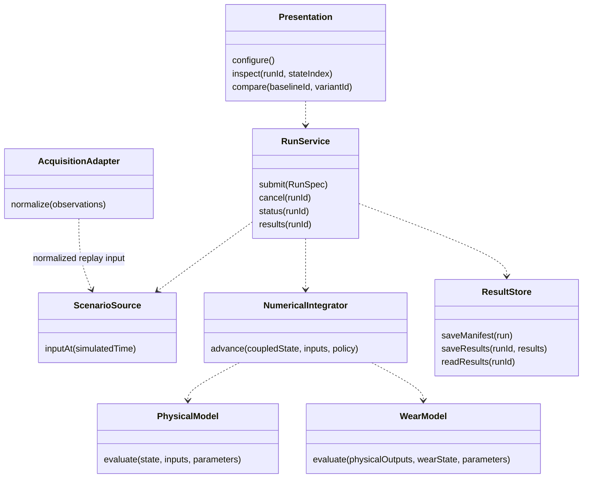
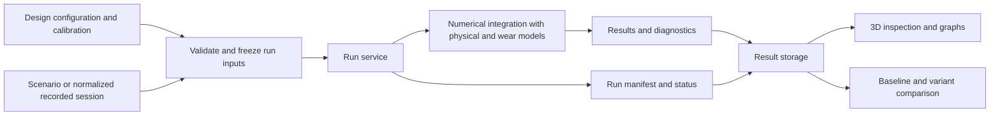
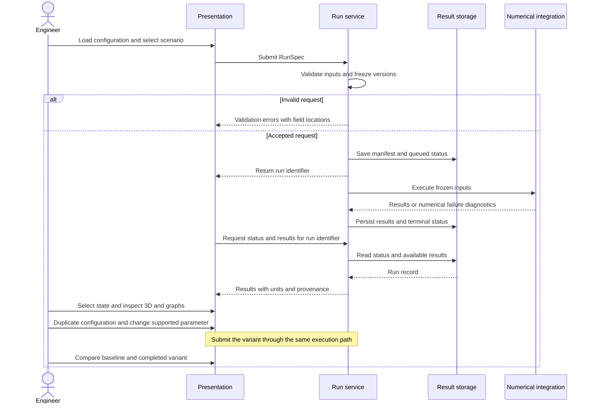

# V-Twin architecture

**Status:** working design for [M1.1 #5](https://github.com/V-Twin-EIP/V-Twin/issues/5), started October 18, 2026. Module boundaries below follow the [product scope](../product-scope.md). Deployment, implementation languages, numerical methods, and storage choices are being established with the owner and the comparative studies.

The first delivery runs a parameterized ring–liner case, records its results, and supports interactive 3D inspection, graphs, and a baseline/variant comparison. The later digital twin reuses the model and run contracts with recorded or acquired observations. Model execution remains usable without the interface.

## Components and dependencies

| Component | Responsibility | Boundary |
| :--- | :--- | :--- |
| Physical model | Evaluate supported mechanical, thermal, and lubrication quantities for a declared state and operating condition. | No rendering, network, database, or wall-clock dependency. |
| Wear model | Evaluate the selected degradation mechanism using physical outputs, material/calibration parameters, and its applicability conditions. | Keep physical wear estimates distinct from exposure indicators; declare the coupling to the physical model. |
| Numerical integration | Advance the coupled state under a documented numerical policy and report solver diagnostics. | The runner owns advancement; the viewer cannot change solver time or step size. |
| Scenario and replay | Provide operating inputs against simulated time from a controlled scenario or a recorded session. | Validate units, ordering, gaps, and any resampling policy before execution. |
| Run service | Validate a run request, freeze configuration/model versions, coordinate execution, and manage run status. | Entry point shared by an eventual interface adapter and a command-line runner. |
| Result storage | Preserve run metadata, inputs, diagnostics, time series, and reproducible result artifacts. | Expose storage operations through a contract independent of the physical model. |
| Acquisition adapters | Convert future vehicle/file/transport observations into the observation contract. | Hardware/transport choices remain in #30/#31; acquisition does not run inside a numerical step. |
| Presentation | Configure a case, inspect simplified 3D geometry, display graphs, and compare recorded runs. | Render results from a selected run and state; rendering frequency does not determine numerical integration. |

The diagram shows logical dependencies rather than deployed services or existing source files.

## Simulation flow

The first comparison changes the supported lubricant viscosity configuration while keeping geometry and scenario fixed. A comparison checks compatible observable definitions and scenario/model provenance before overlaying curves. It reports the changed inputs rather than assuming two runs differ only in the intended parameter.

## Domain contracts

The contracts below define responsibilities for #5. [Schema implementation #7](https://github.com/V-Twin-EIP/V-Twin/issues/7) supplies concrete fields, formats, examples, and validation tests.

| Contract | Required meaning |
| :--- | :--- |
| Design configuration | Engine/contact geometry, materials, lubricant configuration, initial/boundary conditions, units, and parameter provenance. Immutable for a submitted run. |
| Calibration parameters | Identified calibration dataset/procedure, fitted values, applicability, and model version. Separate from editable design parameters. |
| Engine state | Evolving physical and degradation state at simulated time; initial state and restart state identified separately. |
| Scenario or observations | Time-indexed forcing or observations with units, source, coverage, and quality. Synthetic inputs and measurements retain separate origins. |
| Run specification | References to frozen inputs, model/schema/code versions, numerical policy, initial state, scenario, and a random seed if a stochastic model requires one. |
| Observable | Stable identifier, definition, unit, origin category, sampling coordinate, supported domain, and validity/quality. Uncertainty is recorded when the evaluation method provides it. |
| Run record | Identifier, manifest, lifecycle status, results, diagnostics, and terminal error/cancellation reason. Partial results retain an incomplete status. |

### Time and units

The proposed internal conventions use SI units: time in seconds, length in metres, temperature in kelvin, pressure in pascals, and angles in radians. Boundary adapters perform explicit conversions for entries or displays such as millimetres, degrees Celsius, bar, degrees, and RPM. Unit definitions accompany parameter and observable contracts.

Simulated time advances according to the numerical policy. Wall-clock time measures execution cost, and acquisition timestamps identify source observations. These are separate coordinates. The renderer selects a stored state or an explicitly defined interpolation for playback without changing simulation history. Cycle/angle indexing and the mapping to time will be specified with the operating scenario.

The numerical policy must define the method, floating-point precision, integration/output steps, convergence criteria, error controls, and failure conditions. Per-observable tolerances and the evidence for them come from [validation #4](https://github.com/V-Twin-EIP/V-Twin/issues/4). No precision or speed target is inferred from a rendering frame rate.

## Errors and trust boundaries

Imported configuration, result files, future observations, and interface requests cross an input-validation boundary. Validate schemas, units, finite numbers, physical parameter ranges, dataset references, and requested run limits before execution. Model code and storage paths are application-controlled rather than executable content supplied by a configuration file.

Use distinct errors for invalid input, unsupported model conditions, missing evidence or data, numerical failure, storage failure, and cancellation. Correlate diagnostics with a run identifier and retain model-specific details for reproduction. A failed numerical run cannot be displayed as a completed comparison. Detailed implementation is tracked in [#40](https://github.com/V-Twin-EIP/V-Twin/issues/40).

Storage and deployment choices must define atomic publication of complete results, recovery of interrupted runs, configuration/secrets boundaries, and backup/restore of run inputs, calibration references, manifests, and artifacts. The concrete topology depends on the deployment choice being discussed with the owner.

## Decisions to resolve

| Decision | Required input or evidence |
| :--- | :--- |
| Languages and implementation split | Team experience, numerical needs, integration overhead, and a reproducible benchmark workload. |
| Local web, hosted web, or desktop deployment | Owner's preferred first-delivery workflow, target operating systems, offline/access needs, and available hardware. |
| Batch calculation and playback or continuous interactive calculation | Owner's interaction goal, scenario duration, acceptable wait, and supported numerical fidelity. |
| Numerical method and supported precision | Selected equations and coupling, validation protocol #4, wear-model study #33, convergence/accuracy evidence. |
| Transport and storage | Studies #30–#32, offline/deployment constraints, dataset volume, run access patterns, and measured costs. |

Architecture decision records, a deployment view, and the stack comparison will extend this design as those inputs are established. The four studies remain assigned to Slakkos; this document records integration requirements without replacing their evidence.
